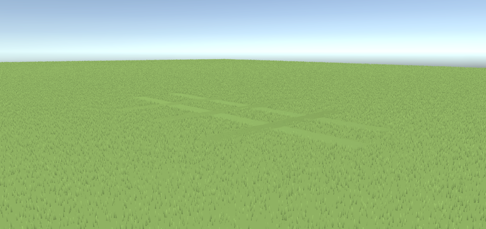

# Project Greenkeeper

> *Stadyum çim müdürü simülasyonu — erken geliştirme aşaması*

Bir futbol sahasının çim müdürü olarak başlıyorsun. Çimi biç, deseni işle, sahayı maça hazırla — para ve itibar kazanarak küçük bir amatör kulüpten ülkenin en büyük stadyumlarına ulaş.

## Geliştirme Durumu

**Faz 0 tamamlandı** — çekirdek biçme mekaniği ve render sistemi çalışıyor.  
Şu an aktif: **MVP (Faz 1)** — zaman sistemi, çizgi çekme, sulama, denetçi karnesi, maç günü.

## Özellikler (Faz 0)

- First-person çim biçme — gerçek zamanlı blade render, LOD sistemi
- GPU tabanlı desen işleme — biçme yönü sahaya şerit kontrastı olarak yansır
- Saha durum simülasyonu — nem, sağlık, hasar CPU grid üzerinde yaşar
- Kesim yüksekliği kontrolü (10–45 mm), sepet sistemi, scalping kuralı
- Prosedürel ses — motor, kesim hışırtısı, tamamlanma

## Teknik

- **Motor:** Unity 6 LTS (URP)
- **Mimari:** ScriptableObject + Event Channel, CPU simülasyon / GPU görselleştirme ayrımı
- **Performans:** ~0.7 ms GPU (RTX 3070 Laptop referans)

## Yol Haritası

- [x] Faz 0 — Çekirdek biçme mekaniği
- [ ] MVP — Zaman sistemi, çizgi çekme, sulama, denetçi karnesi, maç günü, ekonomi
- [ ] Faz 2 — Hava durumu, gübre, ride-on ekipman
- [ ] Faz 3 — Tüm stadyum kademeleri, final senaryosu

---

*Solo proje · Unity 6 · PC (Steam hedef)*
